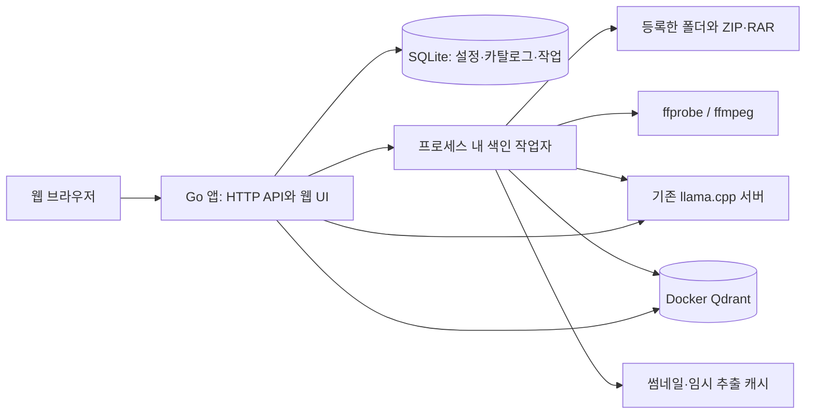

# vgalary Blueprint

- 상태: 백엔드와 웹 UI 1차 구현 완료. 이 문서는 목표 설계이며 백엔드 검증 범위는 [검증 기록](backend-verification.md), 실행·배포 구성은 [배포 문서](deployment.md)를 따른다.
- 갱신일: 2026-10-31 (Asia/Seoul)
- 대상: 프로젝트 소유자와 구현 기여자
- 역할: 프로젝트 범위, 주요 설계, 구현 순서의 기준 문서. 사용자 요구사항과 충돌하면 최신 사용자 결정을 우선한다.
- 갱신 조건: 범위, 설정 정책, 데이터 소유권, 외부 연동 계약, 색인 기준, 실행 구성의 변경

## 1. 목적과 범위

지정한 디렉토리 아래의 이미지와 영상을 EmbeddingGemma 2로 임베딩하고 Qdrant에 저장하여, 웹에서 자연어로 검색하고 원본 위치를 확인하거나 파일을 가져오는 로컬 미디어 검색 서비스를 만든다. ZIP·RAR 내부의 미디어도 일반 파일과 같은 검색 대상으로 다룬다.

### 확정 요구사항

- 백엔드는 Go를 사용한다. 구현을 시작할 때 `go mod init github.com/snowmerak/vgalary`로 초기화한다.
- 수집 루트 아래를 고정 깊이 제한 없이 재귀 탐색하고 ZIP·RAR 내부의 이미지·영상도 색인한다. 압축 안의 하위 폴더와 중첩 ZIP·RAR도 같은 규칙으로 끝까지 탐색하며, 순환 참조는 감지한 분기에서 중단한다.
- 인덱싱할 디렉토리 목록은 앱 설정에 영속 저장하며, 웹 설정 화면에서 추가·제거할 수 있다.
- 기존 llama.cpp 서버를 사용한다. 임베딩 Base URL 기본값은 `http://127.0.0.1:18182/v1`이다.
- 연결 설정은 앱에 영속 저장하고 웹 설정 화면에서 수정한다. 환경 변수 사용은 선택 사항이다.
- URL·Model에 환경 변수 이름을 선택적으로 지정할 수 있다. API Key는 실제 값 대신 환경 변수 이름만 받는다.
- Qdrant 연결도 설정에서 변경한다. 기본 대상은 로컬 Qdrant이며 Docker로 실행한다.
- 영상은 FFmpeg로 프레임을 추출하고 IDR 프레임 중 화면이 충분히 바뀐 프레임만 색인한다. 첫 프레임은 유지하며 각 영상 검색 포인트에는 해당 IDR의 타임스탬프를 기록한다.
- 웹에서 자연어 검색, 원본 경로 확인, 미리보기와 원본 가져오기를 제공한다. 압축 내부 미디어의 미리보기는 선택 사항이며, 화면 표시만을 위해 압축을 추가로 해제하지 않아도 된다.

### 구현 선택과 후속 제안

다음은 위 요구사항을 구현하기 위한 선택이다. 백엔드 라이브러리 버전은 `go.mod`, Qdrant 버전은 `compose.yaml`, 웹 클라이언트 의존성은 `web/package-lock.json`에 고정했다.

- Go 단일 프로세스에 HTTP 서버, 웹 정적 자산, 백그라운드 작업자를 둔다.
- 설정·파일 목록·작업 상태는 앱 데이터 디렉토리의 SQLite에 저장한다.
- Qdrant는 REST API로 접근한다. 기본 URL은 `http://127.0.0.1:6333`이다.
- 기본 Model은 로컬 서버에서 확인한 별칭인 `embed`로 한다. 사용자가 다른 모델 ID로 바꿀 수 있다.
- 웹은 React·TypeScript·Vite를 사용하고 빌드 결과를 Go에 포함한다. 검색·미디어 상세, 디렉토리, 작업 현황, 설정의 네 화면을 제공한다.
- 단일 사용자 앱으로 각 이용자의 컴퓨터에서 실행한다. 설치 안내·스크립트는 Cloudflare Pages의 `vgalary.saturday.ne.kr`에서 배포한다. 앱의 외부 공개는 이용자 선택이며, 선택적 HTTPS 도메인 모드는 환경 변수 비밀번호와 서명 세션을 요구한다. 여러 사용자와 분산 작업자는 후속 범위다.
- 첫 범위에는 OCR, 캡션 생성, 오디오 검색, 영상 재인코딩을 통한 미리보기 호환성 확보를 포함하지 않는다.

## 2. 사용자 흐름

1. 앱을 실행하고 설정 화면에서 임베딩·Qdrant 연결 정보를 확인한다.
2. 연결 테스트로 모델 목록, 텍스트·이미지 임베딩, Qdrant 접근 가능 여부를 확인한다.
3. 앱 설정에서 수집할 서버 측 디렉토리를 추가한다. 여러 디렉토리를 등록할 수 있고, 목록은 앱 재시작 후에도 유지된다. 웹 브라우저가 실행되는 컴퓨터의 경로와 다를 수 있음을 표시한다.
4. 색인을 시작하고 발견·추출·임베딩·저장 진행량과 파일별 실패 이유를 확인한다.
5. 예를 들어 `눈 오는 밤의 거리`처럼 자연어로 검색한다.
6. 썸네일, 유사도, 파일명, 원본 경로를 보고 결과를 선택한다. 영상은 일치한 IDR의 타임스탬프를 보여준다. 압축 내부 항목은 미리보기가 없어도 압축 파일 경로·내부 경로와 영상 타임스탬프로 결과를 확인할 수 있다.
7. 이미지 원본이나 영상 원본을 다운로드하거나, 선택한 서버 측 내보내기 디렉토리로 복사한다. 압축 내부 항목은 해당 파일만 추출한다.
8. 다시 스캔하면 추가·변경·삭제를 반영한다. 변경되지 않은 파일은 다시 임베딩하지 않는다.
9. 앱 설정에서 디렉토리를 제거하면 해당 루트의 새 수집을 중단하고 검색 결과에서도 제외한다. 원본 디렉토리와 파일은 보존한다.

`가져오기`는 브라우저 다운로드와 서버 측 내보내기를 뜻한다. 원본 이동·삭제와 클라이언트 OS의 파일 관리자 실행은 첫 범위에 포함하지 않는다. 내보내기는 충돌 시 새 이름을 부여하며 기존 파일을 묵시적으로 덮어쓰지 않는다.

## 3. 실행 구조



실행 단위는 Go 앱, 기존 llama.cpp 서버, Qdrant 컨테이너다. Go 앱 내부의 작업자는 별도 서비스로 분리하지 않는다. 추론은 기존 서버가 담당하므로 앱에 Python 추론 서비스를 추가하지 않는다.

| 구성요소 | 책임 |
| --- | --- |
| HTTP / 웹 UI | 설정, 수집 루트, 작업 제어, 검색, 미리보기, 다운로드·내보내기 |
| 스캐너 | 깊이 제한 없는 일반·중첩 압축 탐색, 순환 감지, 변경 감지, 스캔 세대 관리 |
| 압축 접근 계층 | ZIP·RAR 항목 열거, 항목 식별, 제한된 임시 추출 |
| 미디어 처리 | 형식 확인, 썸네일 생성, 영상 스트림 분석과 IDR 프레임 추출 |
| 임베딩 클라이언트 | llama.cpp 요청 형식, 인증, 제한 시간, 응답 검증 |
| 벡터 저장소 | 컬렉션 프로필 확인, 포인트 upsert·삭제, 유사도 검색 |
| SQLite 카탈로그 | 설정, 원본 위치, 미디어 리비전, 작업과 포인트 저장 상태 |
| 작업 실행기 | 제한된 동시성, 취소, 재시도, 재시작 후 재개 |

의존 방향은 HTTP/작업 실행기 → 수집·검색 기능 → 파일/압축/미디어/임베딩/저장 어댑터로 둔다. UI와 외부 API의 JSON 형식을 내부 미디어 모델에 직접 전파하지 않는다.

## 4. 설정과 비밀 값

### 저장과 해석 규칙

기본 설정은 SQLite에 저장하고 설정 API를 통해 수정한다. 설정에는 스키마 버전을 둔다. 데이터 디렉토리는 실행 인자로 선택할 수 있고, 별도 지정이 없으면 OS의 사용자 앱 데이터 디렉토리 아래 `vgalary`를 사용한다.

환경 변수만으로 실행하도록 강제하지 않는다. URL·Model은 저장된 기본값을 사용하며, 해당 필드에 환경 변수 이름을 지정하면 앱 프로세스 환경에서 값을 읽는다. API Key에는 원문 입력·저장 필드를 두지 않는다.

| 설정 | 저장 기본값 | 선택적 환경 변수 참조 예시 |
| --- | --- | --- |
| `embedding.base_url` | `http://127.0.0.1:18182/v1` | `embedding.base_url_env`: `VGALARY_EMBEDDING_URL` |
| `embedding.model` | `embed` | `embedding.model_env`: `VGALARY_EMBEDDING_MODEL` |
| `embedding.api_key_env` | 빈 문자열, 인증 없음 | `VGALARY_EMBEDDING_API_KEY` |
| `qdrant.url` | `http://127.0.0.1:6333` | `qdrant.url_env`: `VGALARY_QDRANT_URL` |
| `qdrant.api_key_env` | 빈 문자열, 인증 없음 | `VGALARY_QDRANT_API_KEY` |
| `qdrant.collection_prefix` | `vgalary` | 첫 범위에서는 앱 설정으로 관리 |

표의 환경 변수 이름은 예시이며 예약된 필수 이름이 아니다. UI에서 실제 사용할 이름을 입력한다. 환경 변수 참조가 비어 있으면 URL·Model은 저장값을 쓰고 API Key는 생략한다. 참조 이름을 지정했는데 변수가 없거나 값이 비어 있으면 설정 오류로 처리한다. 인증 없는 연결이나 다른 저장값으로 조용히 대체하지 않는다.

설정 예시의 논리 구조는 다음과 같다. 별도 JSON 설정 파일을 필수로 요구한다는 뜻은 아니다.

```json
{
  "embedding": {
    "base_url": "http://127.0.0.1:18182/v1",
    "base_url_env": "",
    "model": "embed",
    "model_env": "",
    "api_key_env": ""
  },
  "qdrant": {
    "url": "http://127.0.0.1:6333",
    "url_env": "",
    "api_key_env": "",
    "collection_prefix": "vgalary"
  }
}
```

### 인덱싱 디렉토리 설정

디렉토리 목록은 연결 설정과 함께 앱 설정에서 관리하는 `sources` 항목이며 기본값은 빈 목록이다. 각 항목에는 안정적인 `source_id`와 서버 측 `root_path`를 저장한다. 파일·작업 카탈로그도 이 ID를 참조하고, 별도의 중복 디렉토리 목록을 만들지 않는다.

- 웹 설정에서 디렉토리를 추가·제거하고 등록 목록과 접근 상태를 확인한다. 환경 변수나 실행 인자로 수집 경로를 지정하도록 강제하지 않는다.
- 추가 시 서버에서 경로를 정규화하고 디렉토리 여부·접근 가능 여부를 검증한다. 같은 정규화 경로의 중복 등록을 막고, 상하위 루트가 겹치면 이를 표시한다.
- 제거 시 해당 소스를 먼저 비활성화해 검색과 새 작업에서 제외하고, 대기·진행 중인 작업을 취소한다. 작업자는 결과 활성화 전에 소스가 여전히 유효한지 확인한다.
- 해당 소스의 카탈로그·Qdrant 포인트·캐시 정리는 재시도 가능한 작업으로 처리한다. 정리가 지연되거나 Qdrant가 중단돼도 제거된 소스가 검색에 다시 나타나지 않게 한다.
- 다른 소스에도 같은 파일 내용이나 겹치는 경로가 있으면 다른 소스의 등록·검색 결과는 유지한다. 제거는 선택한 소스에만 적용하며 원본을 삭제하지 않는다.

### 연결 설정 적용

- 비밀 값은 요청 직전에 서버에서만 해석한다. UI·설정 응답·로그에는 환경 변수 이름과 설정 유무만 노출한다.
- 임베딩 인증은 필요할 때 `Authorization: Bearer ...`, Qdrant 인증은 `api-key` 헤더를 사용한다.
- 실행 중인 프로세스의 환경 변수는 OS에서 바꾸어도 자동 갱신되지 않는다. 값 변경은 앱 재시작으로 적용한다. 환경 변수 이름 자체는 설정에서 변경할 수 있다.
- 웹 UI에는 저장값, 환경 변수 참조 사용 여부, 적용된 URL·Model, 연결 상태를 구분해 보여준다. 인증 헤더와 비밀 값은 표시하지 않는다.
- 설정 변경은 검증 후 적용한다. 이미 실행 중인 작업은 시작 시점의 연결 설정과 색인 프로필을 사용하며, 작업 도중 새 설정을 섞지 않는다.
- 모델·전처리·프롬프트·차원 등 벡터 호환성이 달라지면 새 프로필로 재색인한다. URL이나 인증 변경만으로 재색인을 강제하지 않되, 연결 대상의 프로필 호환성을 다시 확인한다.
- Qdrant 대상 변경은 데이터 이전을 뜻하지 않는다. 새 대상에서 필요한 컬렉션과 색인을 준비한 후 검색 대상을 전환한다.

## 5. llama.cpp 임베딩 계약

### 확인한 사실과 미검증 항목

2026-10-31에 `GET http://127.0.0.1:18182/v1/models`를 읽어 다음을 확인했다.

- `embed` 별칭이 존재한다.
- 프리셋은 `ggml-org/embeddinggemma-2-GGUF:Q8_0`를 가리키고 `embeddings = true`를 포함한다.
- 모델 메타데이터는 text·image·audio 입력과 `mmproj` 사이드카를 보고한다.
- 최초 조회 시 모델 상태는 `unloaded`였다. 이후 실제 텍스트·이미지 요청과 제공받은 미디어의 색인·검색까지 검증했다.

실제 응답은 텍스트·이미지 모두 768차원이었고 서로 다른 테스트 이미지의 벡터가 구분됐다. 제공된 사진의 한국어 검색도 확인했다. 상세 결과는 백엔드 검증 기록에 남긴다. `models` 응답의 일반 아키텍처 정보만으로 벡터 차원을 결정하지 않는다.

### 요청과 응답

Base URL에는 `/v1`까지 저장하고 그 아래 `models`, `embeddings`를 호출한다. 최종 요청 주소가 `/v1/v1/embeddings`가 되지 않도록 정규화한다.

- 텍스트 질의: `POST /v1/embeddings`에 Model과 텍스트를 보낸다.
- 이미지: 동일 엔드포인트의 llama.cpp 멀티모달 확장을 사용한다. `input`의 각 객체에 `content` 배열을 넣고 `image_url` 파트의 URL로 base64 data URI를 전달한다.
- 압축 항목·영상 프레임도 앱이 읽은 이미지 바이트로 전달한다. 모델 서버가 앱의 파일 경로에 접근할 필요가 없도록 한다.
- `encoding_format`은 `float`를 사용한다. 응답 개수·인덱스 대응, 빈 벡터, NaN/Inf, 차원 불일치를 검사한다.
- 첫 정상 응답으로 차원을 확인하고 프로필·Qdrant 컬렉션에 고정한다. 이후 다른 차원의 응답은 저장하지 않는다.
- EmbeddingGemma 2의 문서상 기본 차원은 768이지만, 서버의 변환·실행 설정을 검증한 결과를 사용한다.

멀티모달 요청 구조는 일반 OpenAI Embeddings API의 표준 입력이 아니라 llama.cpp의 확장이다. 앱에 작은 전용 어댑터를 두고 실제 사용한 llama.cpp 빌드와 호환성 결과를 기록한다. 구형 서버의 다른 엔드포인트로 묵시적 폴백하지 않는다.

질의 프롬프트는 EmbeddingGemma 2의 검색용 프롬프트와 서버 측 자동 처리 여부를 확인해 한 곳에서 적용한다. 중복 적용하지 않는다. 이미지 파트에는 임의의 캡션을 붙이지 않는다. 프롬프트와 이미지 전처리 버전도 색인 프로필에 포함한다.

연결 테스트는 모델 목록 조회, 짧은 텍스트, 앱에 포함한 테스트 이미지 두 장의 임베딩을 구분해 표시한다. 서로 다른 이미지가 항상 같은 벡터를 반환하는지 확인하고, 대표 텍스트-이미지 검색 예제로 교차 모달 동작을 평가한다. 실파일을 임의로 전송하지 않는다.

## 6. 수집과 압축 파일 처리

### 원본 위치 모델

미디어의 논리적 위치와 임시 추출 경로를 분리한다.

- 일반 파일: `source_id` + 루트 기준 상대 경로
- 압축 항목: 위 위치 + 순서 있는 압축 항목 체인
- 영상 프레임: 미디어 위치 + 리비전 + 스트림 번호 + PTS/time base

예를 들어 `D:/media/album.rar`의 `photos/a.jpg`는 압축 파일 경로와 내부 항목 경로를 별도로 저장한다. `album.rar!/photos/a.jpg` 같은 문자열은 표시용으로만 사용하고 내부 식별자를 파싱하는 계약으로 삼지 않는다. 같은 이름의 압축 항목도 구분할 수 있도록 항목 순번 등 안정적인 식별 정보를 보존한다.

### 스캔과 추출

- 확장자로 후보를 좁힌 뒤 디코더·컨테이너 분석으로 실제 처리가 가능한지 확인한다. 지원 확장자와 디코딩 가능한 형식을 구분한다.
- ZIP은 Go 표준 라이브러리를 우선 사용한다. RAR은 RAR4/5와 solid archive를 지원하는 읽기 라이브러리를 실제 샘플로 검증해 선택한다.
- 이미지 항목은 가능한 한 스트리밍하고, 탐색이 필요한 영상 항목은 제한된 작업 임시 디렉토리에 추출한다.
- 색인을 위해 필요한 읽기·임시 추출과 웹 미리보기를 위한 추출을 구분한다. 검색 결과 표시 시에는 기존 썸네일·프레임 캐시만 재사용할 수 있으며, 캐시가 없으면 압축을 추가로 풀지 않고 미리보기 없음으로 표시한다. 사용자가 다운로드·내보내기를 요청한 경우에는 해당 항목을 추출한다.
- solid RAR는 항목 하나를 읽기 위해 앞선 데이터까지 해제해야 할 수 있으므로 같은 압축 파일의 작업을 묶어 불필요한 반복 추출을 줄인다.
- 하위 폴더를 유지하고 유니코드 이름을 지원한다. 내부 이름을 호스트 파일 경로로 그대로 결합하지 않는다.
- 압축 항목의 경로 탈출(`../`, 절대 경로, 드라이브 경로)과 특수 항목은 차단한다. 링크는 아래 탐색 정책에 따라 논리적으로 해석하고, 압축에 포함된 링크를 호스트 파일 시스템에 생성하지 않는다.
- 항목 수, 항목별·작업별 실제 해제 바이트, 임시 디스크 사용량, 처리 시간에 상한을 둔다. 고정된 디렉토리·압축 중첩 깊이 제한은 두지 않는다. 선언된 압축 크기만 신뢰하지 않는다.
- ZIP 안의 RAR, RAR 안의 ZIP 등 지원 압축 형식의 조합을 첫 압축 구현부터 재귀 처리한다. 중첩 위치는 전체 항목 체인으로 보존하고, 다운로드·내보내기도 이 체인을 따라 대상 항목에 접근한다.
- 암호화·분할 압축과 손상된 항목은 지원 여부와 실패 원인을 구분해 표시한다. 첫 범위에는 비밀번호 저장이나 분할 볼륨 자동 결합을 포함하지 않는다.
- 수집 루트와 내보내기·앱 캐시 디렉토리의 겹침을 검사하여 자체 생성 파일이 재수집되지 않게 한다.

현재 백엔드는 스캔한 원본·압축 항목의 내용 해시를 계산해 변경과 재사용을 판단한다. 같은 내용이 여러 경로에 있으면 위치는 모두 보존하고, 프로필과 내용 해시가 같을 때에만 임베딩 재사용을 허용한다. 향후 메타데이터 기반 빠른 스캔을 추가할 경우 크기·mtime이 같은 내용 변경을 놓칠 수 있다는 한계를 별도로 명시한다. 현재 `force`는 같은 내용도 다시 임베딩하는 동작이다.

### 깊이 제한 없는 탐색과 순환 감지

- 함수 호출 스택에 의존한 재귀 대신 명시적인 탐색 스택이나 작업 큐를 사용한다. 깊이가 크다는 이유만으로 건너뛰지 않고, 탐색 상태와 조상 식별 정보를 작업에 보존해 재시작 시에도 같은 정책을 적용한다.
- 일반 디렉토리의 symlink/junction은 해석된 대상이 등록된 해당 소스의 범위 안에 있으면 따라간다. 범위 밖 대상은 자동으로 수집하지 않고 별도 루트 등록이 필요함을 표시한다. 링크가 끊겼거나 대상을 확인할 수 없으면 해당 분기 오류를 기록한다.
- 파일 시스템 순환은 문자열 경로만 비교하지 않고 실제 대상의 파일 시스템 식별자와 현재 조상 디렉토리 집합으로 판정한다. 조상과 같은 대상을 다시 만난 분기만 `cycle_detected`로 건너뛰고 나머지 탐색을 계속한다. 식별자를 확인하지 못한 링크는 추측해서 따라가지 않는다.
- 압축 내부 폴더·중첩 압축에도 같은 분기별 조상 검사를 적용한다. 중첩 압축은 읽은 내용의 해시를 조상 압축의 해시와 비교해 자기 자신 또는 조상과 같은 압축 내용을 다시 펼치는 것을 중단한다. 이 검사를 위해 중첩 압축 바이트를 읽을 때도 해제량·시간 한도를 적용한다.
- 압축 내부 링크는 해당 압축의 가상 경로 공간 안에서 검증 가능한 대상만 해석하고, 논리적 대상 ID로 순환을 검사한다. 압축 밖이나 호스트 경로를 참조하는 링크는 따라가지 않는다. 라이브러리가 링크 대상을 안전하게 해석하지 못하면 해당 항목을 명시적으로 건너뛴다.
- 이미 다른 분기에서 본 디렉토리나 같은 내용의 압축이라는 사실만으로 순환이라 판단하지 않는다. 형제 위치에 복제된 압축과 여러 논리 경로는 보존하고, 분석·임베딩 결과 재사용과 순환 판정을 구분한다.
- 실제 순환은 아니어도 압축 폭탄이나 과도한 작업으로 자원 한도에 도달할 수 있다. 이 경우 `resource_limit_exceeded`로 중단한 범위를 기록하고 불완전 스캔으로 처리한다. 순환으로 잘라낸 참조와 자원 한도로 미탐색한 분기를 구분하며, 미탐색 범위의 기존 색인을 삭제하지 않는다.

## 7. 영상: IDR 기준 프레임 색인

영상 전체를 모델에 직접 보내지 않는다. FFmpeg로 선택한 프레임을 이미지로 추출해 임베딩하고, 검색 결과에 원본 영상과 일치한 프레임의 시점을 연결한다.

### 프레임 선택의 정확한 의미

`pict_type=I`, `key_frame=1`, `-skip_frame nokey`는 엄밀한 IDR 검출과 동일한 계약이 아니다. FFmpeg 문서의 `nokey`는 비키프레임 생략 옵션이다. 이를 IDR 검출이라고 부르지 않는다.

- H.264/H.265는 비트스트림의 IDR 여부를 확인한 접근 단위와 디코딩 프레임의 PTS를 연결한다. H.265의 CRA 등 다른 랜덤 접근 프레임을 IDR로 기록하지 않는다.
- 엄밀한 IDR 검출이 가능한 경로를 기본 정책으로 삼는다. 검출하지 못하면 `idr_detection_unavailable` 또는 `no_idr_found`로 알리고 완료한 것으로 처리하지 않는다.
- IDR 개념이 없는 코덱은 코덱의 랜덤 접근 키프레임 정책을 별도로 적용할 수 있게 한다. 사용자가 폴백을 허용한 경우에만 색인하고 `selection_kind=random_access_keyframe`을 기록한다.
- `trace_headers`와 ffprobe의 프레임·패킷 정보는 검출 구현의 검증 도구로 사용한다. FFmpeg stderr의 사람이 읽는 문자열을 검증 없이 영구 계약으로 삼지 않는다.

현재 구현은 ffprobe의 패킷 데이터를 읽고 H.264/H.265 NAL 종류를 검사한 뒤 PTS로 추출 프레임과 연결한다. Annex B와 길이 접두사가 있는 패킷을 구분하며, 접두사 길이는 스트림 설정에서 읽는다. H.264/H.265의 짧은 B 프레임 포함 영상과 IDR 시점 일치를 검증했고, CRA를 배제하는 파서 테스트도 통과했다. 실제 open-GOP·CRA 샘플을 넓히는 검증은 후속 작업이다. 단순 `select=eq(pict_type,I)` 명령으로 요구사항을 충족했다고 판단하지 않는다.

### 처리 흐름

1. ffprobe로 실제 영상 스트림, 코덱, 시간 기준, 시작 시점, 회전, 크기와 재생 길이를 읽는다. 커버 아트를 영상으로 선택하지 않는다.
2. 기본 영상 스트림에서 IDR 후보와 타임스탬프를 분석한다. 다중 영상 스트림의 전체 색인은 후속 범위다.
3. FFmpeg로 선택 프레임을 디코딩하고 방향·색 공간·해상도를 정규화한다. 원본은 재인코딩하거나 수정하지 않는다.
4. 후보 이미지를 마지막으로 선택한 프레임과 비교해 화면 차이가 임계값 이상인 것만 임베딩한다. 첫 프레임은 항상 선택한다. 선택한 프레임에 `selection_kind`, 해당 IDR의 원본 PTS/time base, 재생 기준 `timestamp_ms`, 스트림 번호, 원본 리비전과 비교 점수를 저장한다. `timestamp_ms`는 처리 시각이나 구간 대표값이 아니라 임베딩한 IDR 프레임 자체의 재생 시점이다.
5. 영상 길이가 길어도 프레임을 제한된 묶음으로 처리한다. 메모리에 전체 프레임을 쌓지 않는다.
6. UI에서 영상 단위 최고 점수로 결과를 묶고, 상세 화면에서는 일치한 프레임들을 시점 순으로 보여준다.

타임스탬프는 프레임 번호/FPS로 추정하지 않고 PTS와 원본 시작 시점을 이용해 계산한다. 음수·누락·중복 타임스탬프를 검증한다. 추출 파일명만으로 시점을 복원하지 않는다.

영상에만 `timestamp_ms`를 기록하고 이미지에는 이 필드를 생략하거나 null로 둔다. 원본 PTS/time base를 함께 보존하므로 밀리초 변환에 의한 반올림과 원본 시점을 구분할 수 있다. 검색 응답과 상세 화면에 해당 값을 포함하고 `HH:MM:SS.mmm` 형태로 표시한다. 압축 내부 영상도 동일하며, 미리보기나 재생을 제공하지 않아도 타임스탬프는 표시한다. 명시적으로 허용한 키프레임 폴백에서는 선택된 키프레임 자체의 시점을 기록하고 IDR과 구분한다.

기본 정책은 후보 프레임을 64×64 RGB로 축소한 뒤 마지막으로 선택한 프레임과의 정규화 평균 절대 차이를 비교한다. 기본 임계값은 `processing.video_frame_change_threshold=0.12`이며 앱 설정에서 0~1 사이로 바꾼다. `0`은 기존처럼 모든 IDR·허용한 키프레임을 임베딩한다. 비교 알고리즘 버전과 임계값도 프로필에 포함해 정책 변경 시 재색인한다. 건너뛴 프레임은 비교 기준을 바꾸지 않아 점진적인 변화도 누적해 감지한다. 이 비교는 모델 호출 전에 수행한다.

프레임별 점수는 두 번째 선택 프레임부터 `change_score`에 기록한다. 저장량을 줄이기 위한 간격 제한이나 프레임 수 제한은 별도의 명시적인 설정으로만 적용한다. IDR 사이에만 나타나거나 화면 변화 임계값에 못 미치는 장면은 검색에서 누락될 수 있다는 한계는 UI 도움말과 검증 결과에 남긴다.

## 8. 데이터와 Qdrant

### 데이터 소유권

| 데이터 | 기준 저장소 | 손실 시 복구 |
| --- | --- | --- |
| 원본 파일·압축 파일 | 등록한 파일 시스템 | 앱이 복구하거나 원본을 수정하지 않음 |
| 설정·루트·논리 위치·미디어 리비전·작업 상태 | SQLite | 앱 데이터 백업에서 복구 |
| 검색 벡터와 검색용 payload | Qdrant | 스냅샷 복구 또는 원본에서 재임베딩 |
| 썸네일·추출 프레임 | 앱 캐시 | 원본에서 재생성 |
| 작업 중 추출 파일 | 앱 임시 공간 | 작업 재시도 시 다시 추출 |

SQLite를 카탈로그와 작업의 기준 상태로 둔다. Qdrant는 검색용 파생 저장소다. 첫 범위에는 벡터 전체를 SQLite에 이중 저장하지 않으므로, Qdrant를 잃으면 추론 비용을 들여 다시 생성해야 한다.

### 컬렉션과 포인트

- 프로필별 컬렉션을 사용하고 거리 함수는 Cosine을 기본으로 한다.
- 프로필은 실제 모델 식별 정보, 사용자 지정 모델 리비전, 벡터 차원, 질의 프롬프트·전처리·프레임 선택 버전을 포함한다.
- 별칭 `embed`는 나중에 다른 가중치를 가리킬 수 있다. 서버가 가중치 체크섬을 제공하지 않으면 사용자가 모델 리비전을 관리해야 하며, 동일 별칭·동일 차원만으로 호환성을 보장하지 않는다.
- 이미지당 한 벡터, 영상은 선택 프레임당 한 벡터를 저장한다.
- 포인트 ID는 위치 ID, 미디어 리비전, 프레임 식별자, 프로필을 바탕으로 만든 결정적 UUID를 사용해 재시도 시 중복 포인트를 만들지 않는다.
- payload에는 `source_id`, `asset_id`, `asset_revision`, `profile_id`, `media_type`, 상대 경로, 압축 항목 위치와 선택 정책을 둔다. 영상 포인트에는 해당 IDR의 `timestamp_ms`와 원본 PTS/time base를 함께 기록하며, 이미지에는 영상 시점 필드를 부여하지 않는다. 절대 경로는 SQLite에서 조합한다.
- 소스·미디어 종류·프로필 등 실제 검색 필터에 필요한 필드만 payload 인덱스를 만든다.
- 새 컬렉션 생성 전 차원과 거리 함수를 검증한다. 기존 컬렉션을 발견하면 스키마를 확인하고 호환되지 않는 곳에 쓰지 않는다.

### 갱신과 재시작

작업 상태는 `queued → running → succeeded / failed / canceled`로 저장한다. 재시작 시 중단된 작업을 재실행 가능 상태로 복구하고, 완료한 리비전·프레임은 재사용한다. 외부 저장 작업의 의도와 완료 여부를 SQLite에 기록한다.

Qdrant와 SQLite 사이에는 단일 트랜잭션이 없다. Qdrant 저장 완료를 확인한 후 SQLite의 저장 완료 상태를 기록한다. 중간에 종료되면 같은 ID로 upsert를 반복해 복구한다. 오래된 포인트 삭제도 재시도 가능한 작업으로 기록한다.

미디어의 새 리비전을 끝까지 저장한 후 SQLite의 활성 리비전을 전환한다. 검색 응답은 Qdrant 후보를 SQLite의 활성 소스·리비전과 대조해 제거된 소스와 미완료·과거·삭제된 항목을 제거한다. 필요한 경우 제한된 추가 조회로 결과 수를 채운다. 새 파일의 일부 프레임만 성공한 상태를 전체 색인 완료로 표시하지 않는다.

삭제는 해당 스캔 범위가 정상적으로 열거된 뒤에만 판정한다. 루트 접근 실패, 압축 열기 실패, 취소, 중간 열거 오류가 있으면 해당 범위의 기존 자료를 일괄 삭제하지 않는다. 변경된 원본과 과거 리비전이 일치하지 않으면 미리보기·다운로드에서 오래된 결과임을 알리고 잘못된 파일을 제공하지 않는다.

Qdrant 장애 시 작업을 실패 또는 재시도 대기로 남기며 완료했다고 표시하지 않는다. 조회는 연결 오류를 빈 검색 결과와 구분한다. 프로필 전체를 재색인할 때는 기존 검색 프로필을 유지하고, 새 프로필이 준비되면 전환한다.

질의 임베딩도 현재 활성 검색 프로필의 모델·프롬프트·차원을 사용한다. 설정 화면에서 새 모델을 저장했다는 이유만으로 과거 벡터에 새 모델의 질의를 보내지 않는다. 기존 모델에 접근할 수 없으면 검색 불가 상태를 명시한다.

## 9. 웹 UI와 앱 API

| 화면 | 주요 기능 |
| --- | --- |
| 검색 | 자연어 입력, 이미지·영상/소스 필터, 썸네일 또는 미리보기 없음 표시, 영상 IDR 타임스탬프, 추가 결과 조회 |
| 결과 상세 | 일반·압축 내부 경로, 영상 IDR 타임스탬프, 가능한 경우 영상 시점 재생, 다운로드·내보내기 |
| 수집 현황 | 설정에 등록한 디렉토리별 상태, 스캔 시작, 강제 재검사 |
| 작업 | 단계별 처리량, 파일별 오류, 재시도·취소, 재시작 후 상태 |
| 설정 | 인덱싱 디렉토리 목록의 추가·제거, URL·Model·환경 변수 참조, 연결 테스트, Qdrant 대상, 처리 한도 |

소스 제거 시 원본은 보존하고 카탈로그·검색 색인만 제거한다. 검색 점수는 유사도이지 정답 확률이 아니므로 백분율 정확도로 표시하지 않는다.

앱 API는 설정 조회·수정/연결 테스트, 소스 관리, 작업 시작·상태·취소·재시도, 검색, 미디어 상세/썸네일/콘텐츠/내보내기로 나눈다. 정확한 URL과 JSON 스키마는 구현 시 소유 API 계약에 정의한다. 이 문서에서 별도의 확정 API 스키마를 중복 관리하지 않는다.

콘텐츠 API는 서버가 발급한 미디어 ID를 받는다. 클라이언트가 보낸 임의의 절대 경로를 그대로 열지 않는다. 일반 영상에는 HTTP Range를 지원한다. 압축 내부 영상의 웹 재생은 필수 기능이 아니며, 이미 유효한 추출 캐시가 있어 제공하기 쉬운 경우에만 Range를 지원할 수 있다. 미리보기·재생이 없으면 경로·IDR 타임스탬프와 명시적인 다운로드·내보내기 동작을 제공한다. 브라우저가 지원하지 않는 코덱은 다운로드를 제공하며 재생 가능하다고 표시하지 않는다.

작업 진행 상황은 폴링으로 시작한다. 실제 필요가 확인되면 SSE로 바꿀 수 있다. 검색 요청이 들어올 때마다 전체 파일을 스캔하거나 압축을 해제하지 않는다.

## 10. Docker와 로컬 실행

### 기본 구성

- Go 앱: 호스트에서 실행, 웹 리스너 기본값은 `127.0.0.1:8181`이다. 공개 도메인은 HTTPS 프록시를 통해 연결한다.
- llama.cpp: 기존 `http://127.0.0.1:18182/v1`을 사용한다.
- Qdrant: Docker Compose로 실행하며 REST 포트 `127.0.0.1:6333:6333`만 기본 공개한다.
- Qdrant 저장 공간: named volume을 `/qdrant/storage`에 연결해 컨테이너 재생성 후에도 유지한다.
- Qdrant 이미지: 구현 단계에서 테스트한 명시적 버전/태그로 고정한다. `latest`를 릴리스 기준으로 삼지 않는다.
- 현재 버전은 `qdrant/qdrant:v1.20.0`이다. 이번 환경에서는 Docker 엔진이 응답하지 않아 사용자 허용에 따라 WSLC로 같은 이미지·포트·named volume을 사용해 실행하고 실제 REST 연동을 검증했다.
- Go 앱의 SQLite·캐시·임시 공간은 구분한다. SQLite 백업은 실행 중 파일의 단순 복사 대신 일관된 백업 절차를 사용한다.

Qdrant의 REST 기본 포트는 6333이고 gRPC는 6334다. 이 설계는 REST를 선택하므로 gRPC 포트를 필수로 열지 않는다. 앱이 Qdrant를 자동 설치하거나 Docker 데몬을 직접 제어할 필요는 없다.

### 앱 컨테이너 실행을 추가할 경우

앱까지 Docker에 올리는 방식은 추가 배포 형태로 지원할 수 있다. 이 경우 별도 Compose 설정에서 다음을 반영한다.

- 컨테이너의 `127.0.0.1`은 호스트나 다른 컨테이너를 뜻하지 않는다. Qdrant URL은 같은 네트워크의 `http://qdrant:6333`을 사용한다.
- Docker Desktop의 호스트 llama.cpp 주소 후보는 `http://host.docker.internal:18182/v1`이다. 호스트의 loopback 전용 바인딩이 이 경로에서 접근되는지는 별도로 확인해야 한다. 필요한 바인딩 변경은 사용자가 운영하는 추론 서버 설정으로 다룬다.
- 미디어 루트는 읽기 전용 마운트, 앱 상태·캐시·내보내기 디렉토리는 별도 쓰기 가능 볼륨으로 둔다.
- Windows 경로를 컨테이너 내부 경로로 자동 간주하지 않는다. 루트 등록 시 컨테이너에서 보이는 경로를 사용한다.
- 선택적 API Key 환경 변수는 앱 컨테이너에도 전달해야 한다. 호스트에 있는 변수만으로 전달되었다고 가정하지 않는다.

## 11. 실패 처리와 운영 기준

- 파일 탐색, 압축 해제, FFmpeg, 임베딩, Qdrant 쓰기에 각각 동시성·시간 제한을 둔다. 영상 처리와 추론의 동시성은 독립적으로 제한한다.
- 일시적인 연결 실패, rate limit, 서버 오류만 제한된 지수 백오프로 재시도한다. 잘못된 설정, 차원 불일치, 손상 파일은 원인을 남기고 사용자 조치 또는 명시적 재시도를 기다린다.
- llama.cpp 모델의 최초 로드가 오래 걸릴 수 있으므로 연결 테스트와 추론 제한 시간을 구분한다. 실제 서버 동작을 보고 기본값을 정한다.
- FFmpeg는 `exec.CommandContext`의 인자로 실행한다. 파일명이나 사용자 입력을 셸 명령 문자열에 합치지 않는다. 취소·타임아웃 시 하위 프로세스도 정리한다.
- 파일은 수집 중 변경될 수 있다. 처리 전후 리비전을 확인해 변경된 입력의 결과를 활성화하지 않는다.
- 종료 시 새 작업 수락을 멈추고 진행 상태를 보존한다. 임시 파일은 정상 종료와 재시작 시 정리하고, 캐시는 용량 상한을 둔다.
- 로컬 단일 사용자 범위에서도 설정 변경·작업 실행·내보내기 API에는 Origin/CSRF 방어를 적용하고 임의 Origin의 CORS를 허용하지 않는다.
- 로그에는 작업 ID, 미디어 ID, 단계, 소요 시간, 재시도 횟수와 오류 종류를 남긴다. API Key, Authorization 헤더, 이미지 base64, 전체 모델 프리셋을 출력하지 않는다.
  - 작업·파일·의존성 로그와 출력 상한을 구현했다. 이벤트 규칙과 격리 검증 결과, 실제 운영 검증과 구분한 제약은 [로그 추가 계획·구현 기록](logging-plan.md)을 따른다.
- 작업 화면에서 실패 파일 수, 색인 완료 이미지·영상·프레임 수, 마지막 성공 스캔, 임시 디스크 사용량을 확인할 수 있게 한다.

## 12. 구현 순서와 수용 기준

아래 표는 프로젝트의 목표 수용 기준이다. 백엔드의 설정·수집·검색·압축·영상·복구 경계와 웹 UI를 구현했으며, 캐시 자동 정리 등 남은 범위를 포함한 전체 단계 완료를 뜻하지 않는다. 현재 API는 [API 문서](api.md), 백엔드 검증과 남은 제약은 [검증 기록](backend-verification.md), 웹 빌드·도메인 실행은 [배포 문서](deployment.md)가 관리한다.

| 단계 | 구현 범위 | 완료 판단 |
| --- | --- | --- |
| 1. 연결 검증과 뼈대 | Go 모듈, 앱 상태 저장, 설정 UI/API, Qdrant Compose, llama.cpp 어댑터 | 환경 변수 없이 기본 연결 가능. 선택적 URL·Model 참조와 API Key 참조의 저장·누락 오류 확인. 실제 텍스트·서로 다른 이미지 임베딩 및 차원 확인 |
| 2. 일반 이미지 검색 | 설정에서 디렉토리 추가·제거, 깊이 제한 없는 스캔과 순환 감지, 이미지 처리, Qdrant 저장, 자연어 검색, 썸네일·다운로드 | 여러 루트가 재시작 후 유지됨. 제거한 루트는 작업 중·Qdrant 장애 중에도 검색에서 제외되고 원본은 보존됨. 깊은 경로의 이미지까지 발견하고 symlink/junction의 자기·조상 참조는 종료됨. 샘플 폴더를 웹에서 색인·검색·다운로드. 재스캔 시 변경 없는 파일의 임베딩 호출 0회. 추가·변경·삭제 반영 |
| 3. ZIP·RAR | 압축 항목 식별, 깊이 제한 없는 중첩 탐색과 순환 감지, 이미지·영상 추출 기반, 자원 제한, 내보내기 | 일반 파일·ZIP·RAR의 동일 샘플 검색 및 원본 해시 일치. 여러 단계의 ZIP↔RAR 중첩에서 가장 안쪽 미디어 발견. 조상 재참조는 중단하고 형제의 동일 압축은 위치 보존. 미리보기 캐시가 없어도 추가 압축 해제 없이 경로·메타데이터 표시. solid RAR·동명 항목·경로 탈출·자원 한도 초과·암호화 파일 동작 확인 |
| 4. 영상 IDR 색인 | 코덱 분석, IDR 검출, 프레임 추출·임베딩, 영상 결과 묶기·시점 표시 | H.264/H.265의 알려진 IDR 시점과 실제 저장 PTS·검색 응답의 타임스탬프 일치. 비IDR I 프레임/CRA를 IDR로 오인하지 않음. 압축 내부 영상도 동일하게 기록하고 미리보기 없이 시점 표시 가능. 이미지에는 영상 시점 없음 |
| 5. 복구와 배포 정리 | 영속 작업, 재시도·취소, 리비전 전환, 캐시 정리, 실행 문서 | 저장 중 강제 종료 후 중복 없이 재개. Qdrant 중단·루트 접근 실패가 완료/전체 삭제로 오인되지 않음. Docker 재생성 후 Qdrant 데이터 유지 |

테스트는 위험한 경계에 집중한다. 설정 해석과 URL 조합, 압축 경로 검증, 조상 기반 순환 판정과 형제 중복의 구분, 프레임-PTS 대응, 결정적 포인트 ID, 불완전 스캔의 삭제 방지는 단위 테스트로 검증한다. 깊은 폴더·중첩 압축에서도 호출 스택이 깊이에 비례해 늘지 않는지 확인한다. 실제 llama.cpp·Qdrant·FFmpeg·RAR 동작은 통합 샘플과 웹의 한 번의 수집→검색→다운로드 흐름으로 확인한다. 외부 서비스가 없어 실행하지 못한 검증은 통과로 기록하지 않는다.

검색 품질은 작은 대표 데이터셋에 한국어 질의와 기대 관련 미디어를 붙여 Top-k 적중과 오탐을 기록한다. 텍스트 벡터와 이미지 벡터의 차원이 같다는 사실만으로 품질 검증을 대신하지 않는다. 검색 지연, 프레임 추출 속도, 추론 처리량, 피크 메모리와 캐시 사용량은 첫 수직 구현에서 측정하고 그 결과를 기준으로 목표치를 정한다.

## 13. 후속 구현과 남은 검증

1. Cloudflare Pages 설치 사이트의 게시·커스텀 도메인 연결. 앱의 외부 공개와 서비스 관리자 등록은 이용자 운영 선택이다. 웹 UI와 설치·빌드·실행 스크립트는 구현했다.
2. 실제 open-GOP·H.265 CRA·다양한 컨테이너와 타임스탬프 불연속 샘플 확대.
3. 선택한 `rardecode/v2`의 RAR5·solid 압축 대표 파일 통합 검증과 압축 내부 링크의 안전한 가상 해석. 현재 제공 데이터로 만든 RAR4 store와 중첩 ZIP·RAR는 검증했다.
4. 전체 캐시 용량 관리, 비정상 종료 후 남은 임시 파일 정리, 이미지 EXIF 방향 처리. 현재 지원 이미지 후보는 JPEG·PNG·GIF·WebP다.
5. 대규모 카탈로그의 조회 인덱스·검색 후보 확장과 성능 목표. 현재 SQLite 카탈로그는 JSON 레코드로 저장하고 읽기 시 필터링하는 1차 구현이다.
6. Windows ARM64에서 실행하지 못한 race 검사. govulncheck는 이후 v1.9.0을 설치해 현재 빌드 구성에서 알려진 취약점 없음으로 확인했다. 정적 검사와 실제 통합 테스트 결과는 검증 기록에 구분한다.

## 14. 외부 근거

외부 문서는 2026-10-31에 확인했다. 아래는 공급자의 문서상 기능이며 로컬 실행 검증과 구분한다. 특히 llama.cpp의 `master` 문서는 변경될 수 있으므로 구현 시 실제 빌드 리비전을 함께 기록한다.

- [EmbeddingGemma 2 모델 카드](https://ai.google.dev/gemma/docs/embeddinggemma/model_card_2?hl=en): 텍스트·이미지·영상의 공유 임베딩 공간과 기본 차원.
- [llama.cpp server README](https://github.com/ggml-org/llama.cpp/blob/master/tools/server/README.md): `/v1/models`, `/v1/embeddings`, 멀티모달 `content` 입력과 이미지 data URI.
- [FFmpeg codecs 문서](https://ffmpeg.org/ffmpeg-codecs.html): `skip_frame`/`nokey`의 의미.
- [FFmpeg bitstream filters 문서](https://www.ffmpeg.org/ffmpeg-bitstream-filters.html): `trace_headers`를 통한 비트스트림 헤더 관찰.
- [Qdrant Local Quickstart](https://qdrant.tech/documentation/quickstart/): Docker 실행, 영속 저장, REST/gRPC 기본 포트.
- [Qdrant Security](https://qdrant.tech/documentation/security/): 로컬 바인딩과 API Key 운영.
